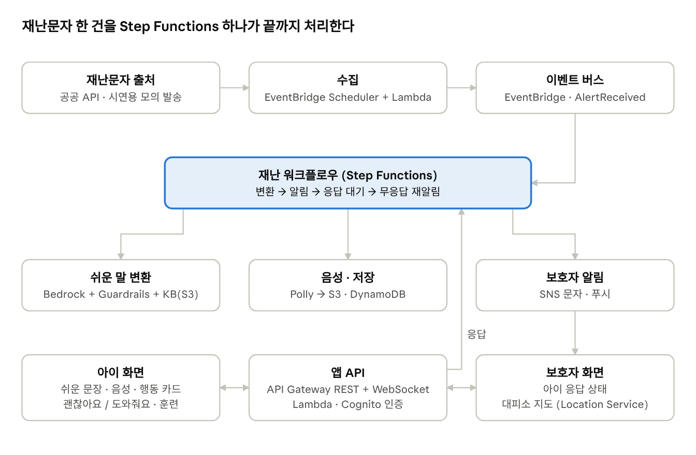
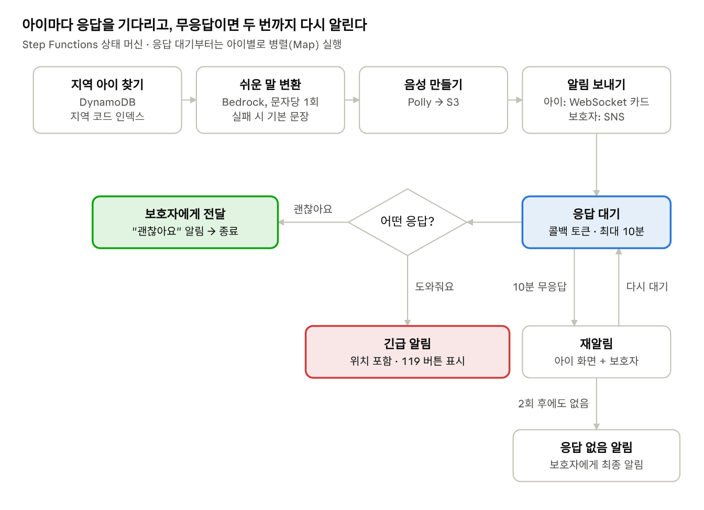

---
tags:
  - computer/project
date: 2026-11-14
---
# 어린이 재난 대응 앱 아키텍처 설계

이 앱의 핵심은 **재난 상황에서 아이가 한눈에 알아보고 바로 행동하게 만드는 것**이다. 보호자 알림은 비슷한 서비스가 많아 기본 기능으로 두고, 훈련은 같은 화면을 평소에 익히는 보조 기능이다. 전체는 서버리스 이벤트 구조로, 재난문자 한 건을 Step Functions 워크플로우가 끝까지 처리한다.

| 메인 아이디어 | 역할 | 담당 구성 요소 |
| --- | --- | --- |
| 1. 아이가 직관적으로 알아보기 | **핵심 차별점** | 쉬운 말 변환(Bedrock + 검수된 행동 카드), 음성(Polly), 아이 화면 |
| 2. 부모와 상호 알림 | 기본 기능 | Step Functions 응답 대기·재알림, SNS, WebSocket |
| 3. 훈련 | 보조 기능 | 듀오링고식 레슨(S3 콘텐츠 + DynamoDB 진도), 실제 재난 때와 같은 행동 카드 사용 |

도우미 캐릭터 Q&A는 범위에서 뺐다.

## 전체 아키텍처

아이가 "괜찮아요"를 누르면 앱 API가 기다리던 워크플로우를 다시 움직이고, 보호자 화면이 바로 바뀐다. 훈련 기능(Lambda + DynamoDB + S3 콘텐츠)은 그림에서 뺐다.

## 핵심 흐름

응답 대기는 Step Functions 콜백(taskToken)으로 만든다. 아이가 버튼을 누르면 앱 API가 토큰으로 워크플로우를 깨우고, 10분이 지나면 타임아웃으로 재알림으로 넘어간다. 대기 시간과 재알림 횟수는 설정값이다.

## 쉬운 말 변환 설계 (핵심 차별점)

아이가 3초 안에 상황을 이해하게 만드는 부분이다. 재난문자 한 건을 **아이 말투 문장 + 그림 행동 카드 + 음성**으로 바꿔 보여 준다. 예: "저지대 침수 우려, 대피 권고" → "물이 차오를 수 있어요! 높은 곳으로 가요"

행동 카드는 AI가 쓰지 않는다. 공식 행동요령으로 미리 만들어 검수한 카드 세트를 재난 유형별로 두고, Bedrock은 **문장 바꾸기와 유형 고르기만** 맡는다. 재난 중 잘못된 행동 안내가 나갈 위험을 구조적으로 막기 위해서다.

**입력:** 재난문자 원문 + Knowledge Base에서 검색한 해당 재난의 행동요령 문단

**출력 (JSON):**

| 필드 | 내용 | 예시 |
| --- | --- | --- |
| `disasterType` | 정해진 목록 중 하나 (지진, 호우, 태풍, 폭염, 화재, 미세먼지, 기타) | 지진 |
| `easyText` | 아이 눈높이 문장, 2문장 이내 | 땅이 흔들리고 있어요! 지금 바로 몸을 지켜요. |
| `hardWords` | 원문의 어려운 단어와 뜻 | 저지대 → 땅이 낮아서 물이 고이기 쉬운 곳 |
| `urgency` | 지금 행동 / 주의 / 알아두기 | 지금 행동 |

**안전장치**

1. 출력은 JSON 스키마로 검증한다. 형식이 틀리거나 길이가 넘치면 재시도 1회, 실패하면 유형별 기본 문장(미리 작성)으로 대체한다.
2. 유형을 모르면 `기타`로 두고 "어른에게 바로 알리고, 보호자에게 연락해요" 카드를 보여 준다.
3. Bedrock Guardrails로 원문에 없는 수치·장소 생성을 막고, 답변 근거성 검사(contextual grounding)를 켠다.
4. 같은 재난문자는 한 번만 변환하고 결과를 저장해 모든 아이에게 재사용한다. 비용과 지연을 줄이고, 아이마다 다른 안내가 나가는 일도 막는다.

## AWS 서비스별 역할

모두 서버리스라 평소에는 거의 비용이 나지 않고, 재난문자가 올 때만 돈다.

| 영역 | AWS 서비스 | 역할 |
| --- | --- | --- |
| 재난문자 수집 | EventBridge Scheduler + Lambda (collector) | 주기적으로 공공 재난문자 API 조회, 새 문자만 이벤트로 발행. 시연은 모의 발송 API로 대체 |
| 이벤트 연결 | EventBridge (custom bus) | `AlertReceived` 이벤트로 워크플로우 시작 |
| 처리 흐름 | Step Functions (Standard) | 변환 → 알림 → 응답 대기 → 무응답 재알림을 하나의 상태 머신으로 관리 |
| 쉬운 말 변환 | Amazon Bedrock + Guardrails | 재난문자를 아이 말투로 바꾸고, 재난 유형 분류, 어려운 단어 풀이 |
| 행동요령 근거 | Bedrock Knowledge Bases + S3 | 공식 국민행동요령 문서를 근거로 검색 |
| 음성 | Amazon Polly | 변환된 문장을 음성 파일로 만들어 S3에 저장 |
| 실시간 화면 갱신 | API Gateway WebSocket API | 아이 화면에 재난 카드를, 보호자 화면에 응답 상태를 즉시 표시 |
| 보호자 알림 | Amazon SNS | 문자·푸시 알림, 재알림 |
| 앱 API | API Gateway (REST) + Lambda | 응답, 훈련, 가족 관리 |
| 로그인 | Amazon Cognito | 보호자·아이 계정 구분 (그룹) |
| 데이터 | Amazon DynamoDB | 가족, 재난문자, 응답, 훈련 기록 |
| 대피소 안내 | Amazon Location Service | 가까운 대피소 검색과 길 안내 |
| 훈련 리마인드 | EventBridge Scheduler | 매일 정해진 시간에 "오늘 미션" 알림 |
| 배포 | AWS Amplify Hosting | 아이 화면 + 보호자 화면 웹 배포 |

## 듀오링고식 훈련 설계

훈련은 AI 없이 정적 콘텐츠 + 진도 기록으로 만든다. 매일 3분 미션을 하고, 연속 기록과 등급으로 다시 오게 만든다.

| 개념 | 설계 |
| --- | --- |
| 코스 | 재난 유형별 코스 (지진, 화재, 호우·태풍, 폭염, 미세먼지 …). 코스 안에 유닛 → 레슨 |
| 레슨 | 문제 3~5개: 그림 고르기, 행동 순서 맞추기, OX. 내용은 실제 재난 때 보는 행동 카드와 같게 만든다 |
| 경험치(XP) | 레슨 완료 시 지급. 틀린 문제는 마지막에 다시 출제 |
| 스트릭 | 하루 한 레슨 이상이면 연속 일수 +1. 끊기면 0 |
| 대원 등급 | XP 누적으로 승급 (예: 새싹 → 훈련 → 베테랑 → 대장) |
| 배지 | 코스 완료, 대피소 확인, 비상 가방 체크 등 안전 행동에만 지급 |
| 리마인드 | 보호자가 정한 시간에 EventBridge Scheduler가 "오늘 미션" 알림 |

레슨 콘텐츠는 JSON 파일로 S3에 두고, 진도·XP·스트릭은 DynamoDB에 저장한다. 실제 재난 중에는 훈련 화면과 보상 연출을 숨긴다.

## 데이터 모델 (DynamoDB)

테이블 5개. 위치는 "도와줘요"를 누른 응답에만 저장한다.

| 테이블 | 파티션 키 / 정렬 키 | 주요 속성 |
| --- | --- | --- |
| `Families` | `familyId` / `memberId` | role(guardian/child), 이름, 연락처(보호자), 지역 코드, 리마인드 시간 |
| `Alerts` | `alertId` | 원문, 지역, 수신 시각, disasterType, easyText, hardWords, urgency, 음성 파일 경로 |
| `Deliveries` | `alertId` / `childId` | status(SENT / OK / HELP / NO_RESPONSE), 재알림 횟수, 응답 시각, 위치(HELP일 때만), Step Functions taskToken |
| `Training` | `childId` / `lessonId` | 완료 시각, 점수, 틀린 문제 |
| `Profiles` | `childId` | XP, 등급, 스트릭, 마지막 훈련 날짜, 배지 목록 |

`Families`에는 지역 코드로 아이를 찾는 보조 인덱스(GSI)를 둔다. 재난문자가 오면 그 지역 아이들만 골라 보낸다.

## API 설계

REST API는 Cognito 토큰으로 인증하고, 화면 즉시 갱신은 WebSocket으로 한다.

| 메서드 | 경로 | 사용자 | 하는 일 |
| --- | --- | --- | --- |
| POST | `/families/children` | 보호자 | 아이 계정 만들기 (보호자 동의 포함) |
| GET | `/alerts/active` | 아이 | 지금 진행 중인 재난 카드 조회 |
| POST | `/alerts/{alertId}/response` | 아이 | 괜찮아요 / 도와줘요 응답 (도와줘요일 때만 위치 포함) |
| GET | `/guardian/status` | 보호자 | 아이별 최근 재난 응답 상태 |
| POST | `/shelters/nearby` | 아이·보호자 | 가까운 대피소 (위치는 URL이 아닌 본문으로) |
| GET | `/training/today` | 아이 | 오늘의 레슨과 스트릭·XP |
| POST | `/training/lessons/{lessonId}/complete` | 아이 | 레슨 완료, XP·스트릭·배지 갱신 |
| POST | `/admin/mock-alert` | 시연용 | 모의 재난문자 발송 |

**WebSocket 이벤트:** `alert.new`(아이 화면에 카드 표시), `child.responded`(보호자 화면 상태 변경), `alert.reminder`(무응답 재알림)

## 개인정보·안전 설계

- **보호자 먼저 가입:** 만 14세 미만은 보호자 동의가 필요하므로, 보호자가 가입한 뒤 아이 계정을 만든다.
- **위치 최소 수집:** 평소 위치 추적 없음. "도와줘요"를 누를 때와 대피소 검색 때만 쓴다. 지역 매칭은 보호자가 등록한 지역 코드로 한다.
- **보조 도구임을 표시:** 공식 재난문자를 대신하지 않는다는 안내를 화면에 둔다.
- **최소 권한:** Lambda마다 필요한 테이블·서비스에만 IAM 권한을 준다.
- **시연은 가상 데이터:** 실제 아동 정보는 쓰지 않는다.

## 확장 가능성

지금 범위에서 AI는 재난문자당 한 번 문장을 바꾸는 정도다. 이후에는 재난 순간이 아닌 **평소**와 **아이 맞춤**에 AI를 넣어 확장할 수 있다. 두 기능 모두 행동 근거는 검수된 문서만 쓰고, AI는 상황에 맞게 풀어 주기만 한다.

| 확장 | AI가 하는 일 | 안전한 이유 |
| --- | --- | --- |
| 우리 집 맞춤 훈련 | 보호자가 등록한 정보(사는 층, 학원 위치, 혼자 있는 시간대)로 아이 상황에 맞는 훈련 시나리오와 문제를 새로 만든다. 자주 틀리는 유형을 골라 다음 레슨을 구성한다. | 재난 중이 아닌 평소에 쓰여 틀려도 위험이 낮다. 생성 결과는 행동요령 KB를 근거로 검증한다. |
| 상황 맞춤 재난 안내 | 같은 재난문자라도 아이가 있는 곳(집·학교·학원)과 층수에 맞춘 한 줄을 더한다. 예: "학원에 있으면 선생님을 따라가요" | 행동 카드는 그대로 검수된 것을 쓰고, AI는 맞춤 한 줄만 붙인다. 실패하면 기본 안내만 보여 준다. |

## 확인 필요

- [ ] 공공데이터포털 재난문자 API 사용 가능 여부와 승인 기간 (어려우면 모의 발송)
- [ ] 대피소 위치 공개 데이터 확보 방법
- [ ] 교육용 AWS 계정에서 Bedrock(모델 접근), Location Service, SNS 문자 발송 사용 가능 여부
- [ ] 아이 화면 알림 방식: 웹앱이라 앱을 열어 둔 상태(WebSocket)가 아니면 알림이 안 갈 수 있음. 시연은 화면을 열어 두고 진행
