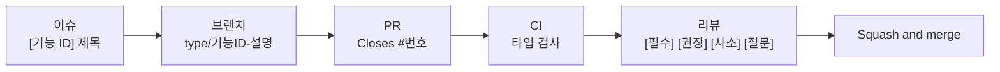

---
tags:
  - computer/project
date: 2026-11-27
---
### 오늘 한 것 (2026-11-21 ~ 11-27)

남은 기능(내 정보 수정, 차단 목록, 일기 수정·삭제)을 채우고, 푸시 알림을 마무리했다. 그다음 기능을 더 만들기 전에 **저장소를 정리했다.** 코드는 기능별 폴더로, 문서는 저장소 안으로 옮기고, 이슈 → 브랜치 → PR로 작업하는 규칙을 정했다. 코드 검사(ESLint, Prettier)와 색·글자·간격 토큰도 넣었다. 디자인은 시안을 5번 만들어 본 뒤, 평범한 UI에 공책 표지 하나만 두기로 하고 나머지는 미뤘다.

| 순서 | 작업 | 상태 |
|---|---|---|
| 1 | 내 정보 수정, 차단 목록·해제, 일기 수정·삭제 (`hidden_at` 구멍 수정) | 완료 |
| 2 | 푸시 알림, CI | 코드·DB 완료, 폰 확인은 앱 빌드 후 |
| 3 | 기능별 폴더(`src/features`, `src/shared`)로 코드 이동 | 완료 (#15) |
| 4 | 문서를 PROJECT, FEATURES, ARCHITECTURE, ADR로 분리, CONTRIBUTING.md 작성 | 완료 (#15, #20) |
| 5 | ESLint, Prettier 도입 | 완료 (#18) |
| 6 | 색·글자·간격 토큰(`theme.ts`) 적용 | 완료 (#19) |
| 7 | Jest 테스트 | 브랜치에서 작업 중 (`test/17-jest`), 아직 병합 전 |
| 8 | 디자인 방향 결정 | 결정, 적용은 미룸 |

---

### 1. 내 정보 수정, 차단 목록, 일기 수정·삭제

- **내 정보 수정**: 닉네임, 읽을 언어, 국적(공개 여부 포함), 지역을 바꿀 수 있다. 학생 구분은 고정이다. `update_my_profile` 함수 하나로 처리한다.
- **차단 목록**: 설정에서 차단한 사람을 보고 해제한다. `blocks.unblocked_at`을 추가해서 해제해도 기록은 남긴다. `is_blocked`와 번역 함수는 해제된 차단을 무시하고, 다시 차단해도 된다. 이미 끝난 매칭은 해제해도 돌아오지 않는다.
- **일기 수정·삭제**: 내 일기 화면에서 글자 수를 세면서 바로 수정한다. 삭제할 때는 한 번 더 묻고, 매칭 후에 지우면 단계가 내려갈 수 있다고 알려 준다. `updated_at`은 내용이 바뀔 때만 바뀌도록 트리거 순서를 고쳤다.

**보안 구멍: 작성자가 `hidden_at`을 지울 수 있었다.**
일기 수정 정책(`diaries` update policy)이 작성자에게 행 전체를 고칠 권한을 줬다. 그래서 운영자가 신고 때문에 숨긴 일기(`hidden_at`)를 작성자가 `null`로 되돌려 다시 피드에 올릴 수 있었다. 수정 기능을 만들면서 이 경로가 실제로 열린다는 걸 알았다. 트리거가 `hidden_at`을 항상 기존 값으로 유지하게 막았다.

### 2. 푸시 알림 (간단히)

- 징 도착, 매칭, 새 메시지, 새 질문에서 DB 트리거가 `pg_net`으로 Expo 푸시 API를 부른다. 알림 문구는 익명이고, 채팅은 2분에 한 번만 보낸다.
- `pg_net`은 `extensions` 스키마에 설치했다. 보안 점검 경고는 해결했다.
- Android Expo Go에서는 원격 푸시가 안 돼서(SDK 53 이후) 실제 확인은 `eas init`과 개발 빌드 뒤로 미뤘다.
- GitHub Actions로 타입 검사, Expo 설정 검사, 약관 사이트 빌드를 자동으로 돌린다.

### 3. 저장소 구조화

그동안 코드는 `screens/`, `components/`, `lib/`에 섞여 있었고, 명세서는 TIL 저장소에 있어서 코드와 따로 고쳐졌다. 모든 변경을 `main`에 바로 커밋해서 왜 바꿨는지도 찾기 어려웠다. 팀 프로젝트 저장소 두 곳(카카오테크캠퍼스 팀, knu-aws-team2)을 보고 방식을 가져왔다.

**코드: 기능별 폴더**

```text
src/
├── App.tsx          # 진입
├── navigation/      # 탭과 화면 스택
├── features/        # auth, feed, diary, matches, exchange, chat, ...
└── shared/          # api, ui, 상수, 타입
```

- 동작은 그대로고 파일 위치와 import 경로만 바꿨다.
- `src/app`은 Expo Router 폴더로 인식돼서, `App.tsx`와 `navigation`은 `src` 바로 아래에 뒀다.
- `shared`는 `features`를 import하지 않는다. 두 기능 이상이 쓰는 것은 `shared`로 올린다.
- `.editorconfig`, `.gitattributes`(LF), `.npmrc`(`save-exact`)를 넣고 의존성 버전을 정확히 고정했다. `npm run typecheck` 스크립트도 만들어 CI가 같이 쓴다.

**문서: 저장소 안으로**

| 문서 | 내용 |
|---|---|
| `docs/PROJECT.md` | 대상, 원칙, 정책, BM (예전 PRODUCT.md) |
| `docs/FEATURES.md` | 기능 ID, 사용자 스토리, 완료 기준, 상태 |
| `docs/ARCHITECTURE.md` | 구조, 폴더, 기능별 흐름 (예전 technical-overview.md) |
| `docs/decisions/` | 기술 결정 기록(ADR). 지난 결정 6개를 옮겨 적음 |
| `docs/api-reference.md` | 테이블, DB 함수, 앱 함수 |
| `docs/design-system.md` | 색, 글꼴, 부품 규칙 |

- 기능 ID는 `ACCOUNT`, `DIARY`, `FEED`, `ZING`, `EXCHANGE`, `TRANS`, `SAFETY`, `PUSH` 접두어에 번호를 붙인다. 이슈, 브랜치, PR이 모두 이 ID로 기능을 가리킨다.
- README에는 "지금 어디쯤인가", 문서 안내, 처음 읽는 순서를 넣었다.
- TIL 저장소에는 개발일지만 남긴다.
- 규칙 문서는 처음에 여러 곳에 있었는데 `CONTRIBUTING.md` 하나로 모았다. README, FEATURES, ADR의 링크도 이쪽으로 바꿨다.

### 4. 작업 방식: 이슈 → 브랜치 → PR

혼자 하는 프로젝트여도 PR을 거치면 합치기 전에 한 번 더 확인하게 되고, CI가 깨진 코드를 막는다. 병합 버튼을 누르는 순간이 확인 지점으로 분명해진다. 대신 작업마다 브랜치·PR 단계가 늘어난다.



- **이름**: 이슈·PR 제목은 `[기능 ID] 한국어 제목`이다. PR 제목은 문장이 아니라 짧은 명사형으로 쓴다(예: `[DESIGN] 색·글자·간격 토큰(theme.ts) 적용`). 기능이 아닌 일은 `[SETUP]`, `[DESIGN]`, `[RELEASE]`, `[DOCS]`를 쓴다. 브랜치는 `type/기능ID-설명`(예: `feat/ZING-04-poke`, `chore/16-lint`)이다.
- **커밋**: `type(scope): 한국어 요약`. type은 `feat`, `fix`, `refactor`, `style`, `docs`, `test`, `chore`, `db`다. 커밋 하나에는 한 가지 일만 담는다.
- **라벨**

| 묶음 | 라벨 | 규칙 |
|---|---|---|
| 종류 | `type: feat` `type: fix` `type: refactor` `type: style` `type: docs` `type: chore` `type: test` | 하나만 |
| 영역 | `area: app` `area: db` `area: functions` `area: release` | 바뀌는 곳 모두 |
| 상태 | `blocked: decision` | 정하지 않은 것 때문에 시작할 수 없을 때 |

- **이슈 양식**: 기능 링크, 범위, 결정됨, 구현하며 정할 것, 완료 조건. 하루 이틀 안에 끝날 크기로 나눈다.
- **PR 본문 섹션**: 이번에 한 일, 범위(포함·제외), 설계 결정, 영향, 검증, 리뷰에서 봐주셨으면 하는 곳, 남긴 것. 여기에 FEATURES 갱신, ADR, 배운 것, 설명할 수 있는 코드 확인 항목을 더했다. 내가 설명할 수 없는 코드는 올리지 않고, 모르는 부분은 "봐주셨으면 하는 곳"에 질문으로 적는다.
- **리뷰 태그**: 요약 댓글 1개와 인라인 댓글로 남긴다. 인라인 댓글은 태그로 시작한다.

| 태그 | 뜻 |
|---|---|
| **[필수]** | 병합 전에 고쳐야 함. 버그, 보안, 규칙 위반, 데이터 손실 |
| **[권장]** | 고치면 좋음. 경쟁 상태, 빠진 검증 |
| **[사소]** | 이름, 주석, 정리. 안 고쳐도 병합 가능 |
| **[질문]** | 의도를 확인하고 싶음 |

- **리뷰 반영**: 같은 브랜치에 `fix(scope): 리뷰 반영 - 무엇을` 커밋을 쌓는다. 반영하지 않은 지적은 이유를 적는다.
- **이슈 댓글**은 결정이 생겼을 때, 막혔을 때, 범위가 바뀌었을 때만 단다. 진행 상황을 매일 적지 않는다.

### 5. ESLint와 Prettier

- ESLint(`eslint-config-expo`)와 Prettier를 같이 쓰고, 둘이 부딪치지 않도록 `eslint-config-prettier`를 넣었다. `npm run lint`, `npm run format`으로 돌린다.
- 전체 코드를 Prettier로 한 번 정리했다. 이 커밋은 `style`로 따로 분리해서 내용 변경과 섞이지 않게 했다.
- ESLint 오류 중 하나가 **렌더 중에 `ref`에 값을 대입하는 코드**였다. 렌더 중 대입은 렌더가 다시 일어나거나 중단될 때 값이 어긋날 수 있다. 피드와 채팅 두 곳에서 `useLayoutEffect` 안으로 옮겼다. 리뷰에서 [권장]으로 잡은 항목이었다.
- 커밋 전에 `npm run typecheck`, `npm run lint` 순서로 돌리기로 했다.

### 6. 테마 토큰

- 화면마다 색을 직접 적어서(`#1F2A44` 같은 값) 바꾸기 어려웠다. 색, 글자 크기, 간격을 `src/shared/theme.ts` 한 곳에 모으고, 화면의 하드코딩 색을 `colors.ink`처럼 토큰으로 바꿨다.
- 이번에 바꾼 건 값의 위치뿐이고 화면은 그대로다. 새 디자인을 입히기 전에 바탕을 만든 것이다.
- 리뷰 반영: 스위치와 버튼 색을 토큰으로 지정했고, 누르는 요소의 테두리를 대비 3:1 기준을 넘는 `line` 색으로 맞췄다.
- 이후 화면에서는 색을 직접 적지 않는다(CONTRIBUTING 규칙).

### 7. Jest 테스트

- 별도 브랜치(`test/17-jest`)에서 하고 있고 **아직 병합하지 않았다.**
- Jest 설정을 추가하고, 순수 함수부터 테스트했다. 비밀번호·학교 메일·오류 문구(auth), 익명 표시(profile), 일기 변환(diary)이다.
- `CONTRIBUTING.md`에 테스트 규칙을 추가했고, CI에도 테스트를 넣었다.
- 화면 테스트보다 DB 규칙이 더 중요하지만, DB는 이 방식으로 확인하기 어렵다. 우선 앱 쪽 변환 함수부터 지킨다.

### 8. 디자인 탐색 정리

**시안을 5번 만들었다.**

- 1~3차 시안은 "어디선가 본 평범한 화면 같다"는 평가를 받았다. 이유를 따져 보니 이랬다.
  - 원칙 목록에서 출발해서, 원칙을 다 지킨 평균적인 화면이 됐다.
  - 사람 손 흔적이 없는 장식이 많았다.
  - 화면에 설명투 문구가 많았다.
  - 예시 내용이 전형적이었다.
- 참고한 곳은 **앱 11개의 App Store 화면 44장**과 **교환일기 서비스 2곳(둥지, 덕지)** 이다. 비교해 보니 앱들은 UI 자체는 평범하다. 개성은 색 하나, 대표 요소 하나, 그리고 내용에서 나온다.

**선택지**

| 선택지 | 내용 |
|---|---|
| A. 평범한 UI + 색 하나 | 당근·토스형 |
| B. 글이 주인공 | 일기 문장을 크게 |
| C. 아바타 중심 | Slowly형, 그림 세트가 필요함 |
| 5차안 | 색(잉크·종이·인주)은 유지하고, 과감한 요소는 "매칭 = 공책 표지" 하나만 두고, 나머지는 평범하게 |

**결정: 5차안.** 공책 표지가 "매칭 = 함께 쓰는 공책"이라는 Zing의 구조를 그대로 보여 준다. 감수하는 점은 두 가지다. 크림 배경에 명조 본문은 흔한 조합인데, 색이 마음에 들어서 유지했다. 스티커와 로고는 직접 만들어야 한다(#12).

**디자인 작업은 미뤘다.** 표지 적용(#1, #2, #3)은 뒤로 돌렸다. 대신 토큰을 먼저 넣어 두었으니 나중에 값만 바꾸면 된다.

### 9. 새 저장소로 옮기기로 한 것

- 지금 저장소는 시안, 구조 변경, 실험 커밋이 쌓여 있다. 기능이 끝나면 **깨끗한 새 저장소로 옮긴다.** 현재 구조(기능별 폴더, 문서, 템플릿)는 그대로 가져간다.
- 이 저장소에서 쓰는 규칙(CONTRIBUTING)은 새 저장소에서도 그대로 쓴다.

### 10. 이번에 배운 것

- **규칙을 강제하는 수단이 없으면 규칙이 문서에만 남는다.** 타입 검사, ESLint, Jest를 CI에 올리고, PR 템플릿에 확인 항목을 넣는 것이 문서보다 효과가 있다.
- **수정 기능은 숨겨진 권한을 드러낸다.** 일기 수정을 만들기 전에는 작성자가 `hidden_at`을 건드릴 일이 없어서 구멍이 안 보였다. 새 쓰기 경로를 만들 때는 정책이 어떤 컬럼까지 허용하는지 확인한다.
- **포맷 정리 커밋은 따로 낸다.** Prettier로 전체를 바꾼 커밋이 내용 변경과 섞이면 리뷰가 불가능하다.
- **시안은 원칙 목록에서 시작하면 평균으로 수렴한다.** 참고 앱을 먼저 많이 보고, 개성을 둘 곳을 하나로 정하는 편이 낫다.
- **문서는 한 곳에만 적고 링크한다.** 규칙이 여러 문서에 있으면 하나만 고쳐지고 나머지는 어긋난다.

### 11. 남은 과제

- 폰에서 푸시 확인 (`eas init`, FCM, 개발 빌드)
- 도메인, 사이트, 문의 메일, SMTP 연결 (그 전까지 인증 메일은 내 주소로만 감)
- 실제 계정으로 끝까지 테스트: 가입 메일, 탈퇴
- `test/17-jest` 리뷰 후 병합
- 공책 표지와 새 디자인 적용 (#1, #2, #3), 스티커·로고 제작 (#12)
- 기분 태그(DIARY-04), 콕 찌르기(ZING-04) 구현
- 기능 완료 후 새 저장소로 이전
- 오류 모니터링(Sentry)
